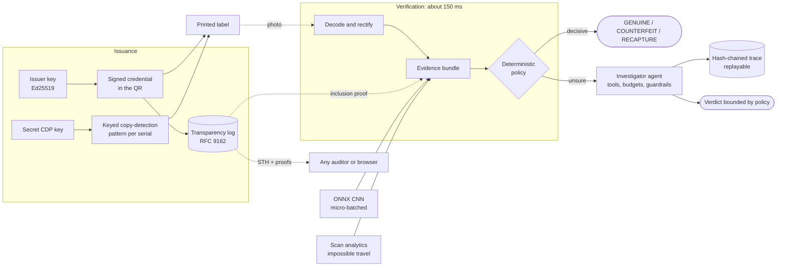

# Sigil

**Counterfeit detection you can audit.** Every product label carries a signed QR credential, a secret
copy-detection pattern that computer vision can check, and an entry in a public transparency log.
Scans the deterministic checks cannot settle go to an LLM investigator that runs on a purpose-built
agent harness: budgeted, policy-bounded, traced, replayable and measured by an eval suite that gates CI.

It runs on a laptop with no API keys. Claude is optional and pluggable.

```bash
uv sync
uv run sigil demo        # a narrated end-to-end run in your terminal, about 6 seconds
uv run sigil serve       # then open http://localhost:8000
```

## Why

Counterfeit goods are roughly 2.5 % of world trade (OECD/EUIPO). The usual answer is a serialised QR
code that a server declares "genuine". That fails in four ways:

| Failure | Why |
|---|---|
| **A QR code is just data** | A photocopy scans exactly like the original, so "is this serial registered?" proves nothing about the object in your hand. |
| **Cloned serials** | One real label copied onto 10,000 fakes: every copy decodes to a valid serial. |
| **Trust in the operator** | The verifier is a server the brand runs. Nobody can audit what it signed or when. |
| **Binary answers** | Real photos are blurry and glare-ridden. A system that can only say yes or no is either insecure or annoying. |

This repository replaced a 2022 prototype that made all of these mistakes
(`FakeProductDetector.sol`, a Next.js + Solidity 0.4 app, still in the git history). It looked product IDs
up on a public chain, so a photocopied label passed; it paid gas per product; and its
`transferOwnership(index, _currentOwner, _newOwner)` never compared the caller with `_currentOwner`, so
anyone could move anyone's product to any registered user. Sigil keeps the goal (provable provenance)
and replaces the mechanism: a binding between the digital identity and the physical print, and a
transparency log instead of a blockchain.

## How it works



1. **Issue.** A batch is signed, appended to the log (the tree head is re-signed), and rendered as labels:
   the QR beside a pattern generated from `HMAC(cdp_key, serial)`. A simulated line camera samples
   the batch to record its print-quality baseline.
2. **Scan.** The photo is decoded and rectified, then checked in parallel: signature, key status, log
   inclusion, the CDP score (a two-input CNN against the expected template, plus a classical
   correlation baseline) and clone analytics. Each fact becomes an evidence item with a stable id.
3. **Decide.** A fixed rule table maps the evidence to a verdict. Most scans end here.
4. **Investigate.** Only the unsure ones reach the agent. It gathers evidence with tools, may ask for a
   retake, and must finish with a verdict that cites evidence. The policy decides which verdicts it is
   allowed to reach, so no model can talk a failed signature into `GENUINE`.

## What's inside

**Trust core** &ndash; [`crypto`](src/sigil/crypto), [`ledger`](src/sigil/ledger), [`scans`](src/sigil/scans)
- Canonical binary credentials (Ed25519, base45 in QR alphanumeric mode, version 9-M), key ids and revocation.
- An RFC 9162 Merkle log in SQLite: signed tree heads, inclusion and consistency proofs, property-tested
  against the RFC vectors, plus an independent `Auditor` that detects a rewritten history.
- Clone analytics: impossible travel, geographic dispersion, scan volume and device diversity.

**Vision and inference** &ndash; [`vision`](src/sigil/vision), [`cdp`](src/sigil/cdp), [`inference`](src/sigil/inference)
- QR detection, homography rectification, ECC sub-pixel alignment and a quality gate that returns
  `RECAPTURE` instead of guessing. The same `extract_cdp_patch` and `make_input` run in training, serving
  and evals, so train/serve skew cannot creep in.
- A 61k-parameter CNN served by ONNX Runtime behind an asyncio **dynamic micro-batcher** with a bounded
  queue, per-request timeouts, Prometheus metrics and a benchmark harness. See the [model card](docs/MODEL_CARD.md).
- A parameterised print/scan channel and three attacks (photocopy, high-quality reprint, screen replay),
  with *disjoint* train and test parameter ranges to measure generalisation.

**Agent harness** &ndash; [`harness`](src/sigil/harness) (imports nothing else from Sigil)
- An **append-only** history (provider prompt caches and reasoning blocks stay valid), parallel tool
  calls returned in one message, and budgets on steps, tokens, dollars and wall-clock.
- A terminal tool plus **guardrails**: a rejected submission is handed back to the model to fix.
- A **hash-chained JSONL trace** of every request, response, tool call and guardrail decision, and
  deterministic **replay** against changed tool code with no model call.

**Investigator** &ndash; [`investigator`](src/sigil/investigator), [`verify`](src/sigil/verify)
- Six typed tools (evidence, batch baseline, scan history, log proof, request recapture, submit verdict).
  Label text is attacker-controlled, so it only ever appears fenced under an `untrusted` field.
- Four guardrails: citations must exist, the verdict must be allowed by the policy, `GENUINE` must rest on a
  CDP measurement that fits the batch, and a high clone risk must be acknowledged.
- An offline **reference policy** implements the same procedure as a scripted model. It is the free,
  deterministic floor that an LLM is compared against.

**Evals** &ndash; [`evals`](src/sigil/evals), [docs/EVALS.md](docs/EVALS.md)
- Eleven scenario kinds from clean genuine labels to forged signatures, unlogged insider mints and a
  prompt-injection attempt, each with a ground truth and a set of acceptable verdicts. Every case runs in
  its own deterministic world.
- Metrics include false-accept rate (the safety metric), friction, escalation and agent resolution rates,
  cost and latency. `sigil eval --gate` fails CI on a regression.

## Quickstart

```bash
uv sync                          # Python 3.12+, everything needed to run
uv run sigil demo                # issue, photograph, counterfeit, verify, investigate, audit
uv run sigil serve               # API + web demo on http://localhost:8000 (/docs for OpenAPI)
docker compose up                # the same, in a container with a data volume
```

The first start issues two demo batches. In the web demo you pick a label, "photograph" it as the genuine
item or as a photocopy, reprint or screen replay, and scan it. The verdict card shows the evidence table and
timings, and an escalated scan shows the agent's timeline live. A side panel verifies the transparency log
**in your browser** with WebCrypto: the tree head signature, a Merkle inclusion proof recomputed from the
QR text, and a consistency proof against the last head your browser saw. You do not have to trust the server.

| Command | What it does |
|---|---|
| `sigil demo` | Narrated end-to-end run with evidence tables, the agent timeline and log verification |
| `sigil serve [--host --port]` | The API and web demo |
| `sigil issue --sku X --count N [--labels DIR]` | Issue a batch (optionally write the label PNGs) |
| `sigil simulate SERIAL [--attack photocopy] -o photo.jpg` | A simulated phone photo of a label |
| `sigil scan photo.jpg [--lat --lon]` | Verify a photo, investigating if unsure |
| `sigil eval [--model reference] [--seeds 3] [--kinds ...] [--gate]` | Run the scenario suite and write a report |
| `sigil bench [--concurrency 1,8,32] [--duration 5]` | Inference throughput and latency, batched vs. unbatched |
| `sigil trace show\|verify\|replay PATH` | Render, hash-check or replay an investigation trace |
| `sigil audit [--url ...]` | Act as a log witness: verify a new tree head extends the last one you saw |

### API

| Endpoint | |
|---|---|
| `POST /v1/batches` | Issue a batch (needs `X-API-Key`; `SIGIL_API_KEY`, default `dev-key`) |
| `POST /v1/scans` | Multipart photo upload (8 MB cap); returns the verdict, evidence and, if unsure, an `investigation_id` |
| `GET /v1/investigations/{id}` | Status, outcome and the agent trace (partial while it runs) |
| `GET /v1/log/sth`, `/inclusion`, `/consistency` | Signed tree head and proofs, for any client to verify |
| `GET /v1/keys`, `POST /v1/keys/{kid}/revoke` | Public keys and revocation |
| `GET /metrics`, `GET /healthz` | Prometheus text and health |

`POST /v1/simulate/{serial}` and `GET /v1/labels/{serial}.png` exist for the demo only. A real deployment
never serves a label's CDP.

## Using Claude as the investigator

```bash
export ANTHROPIC_API_KEY=sk-ant-...
export SIGIL_INVESTIGATOR_MODEL=claude-opus-5-5     # default: "reference" (offline)
uv run sigil serve
uv run sigil eval --model claude-opus-5-5 --seeds 3  # measure it against the reference baseline
```

The same harness, tools, guardrails and traces apply. Budgets default to 10 steps, $0.25 and 90 s per
investigation (`SIGIL_AGENT_MAX_STEPS`, `SIGIL_AGENT_MAX_COST_USD`, `SIGIL_AGENT_MAX_WALL_S`). When the budget
runs out, or the model refuses or errors, the scan resolves to `SUSPICIOUS`: the system never claims a
verdict it could not reach. Run the eval with a real model once, and `sigil trace replay reports/eval/traces/<case>.jsonl` re-runs
any of its investigations against the current code and guardrails for free.

## Results

Numbers come from the commands shown, on the simulated channel (see [Limitations](#limitations)).

**Scenario evals, reference investigator** (`sigil eval --model reference --seeds 3 --gate`)

<!-- RESULTS:EVAL:BEGIN -->
| Metric | 3 seeds (CI gate, 33 cases) | 8 seeds (88 cases) |
|---|---:|---:|
| **False accept rate** (counterfeit passed as genuine) | **0.000** | **0.000** (0 / 56) |
| False reject rate (genuine called counterfeit) | 0.000 | 0.000 (0 / 32) |
| Accuracy (final verdict acceptable) | 0.879 | 0.909 |
| Accuracy excluding `RECAPTURE` | 0.960 | 0.985 |
| Escalated to the investigator | 21 % | 19 % |
| Guardrail / policy violations | 0 | 0 |

Forged and unlogged credentials are rejected by the policy 100 % of the time, before any model runs.
Most friction is by design: deliberately hard photos ask for a retake, and genuine items whose serial was
cloned elsewhere stay `SUSPICIOUS`. Per-kind results and the reasoning are in [docs/EVALS.md](docs/EVALS.md).
<!-- RESULTS:EVAL:END -->

**Inference serving** (`sigil bench --concurrency 1,8,32 --duration 5`)

<!-- RESULTS:BENCH:BEGIN -->
| concurrency | mode | req/s | speed-up | p50 ms | p95 ms | mean batch |
|---:|---|---:|---:|---:|---:|---:|
| 1 | unbatched | 284 | 1.00× | 3.2 | 4.9 | 1.0 |
| 1 | batched | 308 | 1.08× | 3.0 | 4.4 | 1.0 |
| 8 | unbatched | 314 | 1.00× | 24.9 | 30.6 | 1.0 |
| 8 | batched | 384 | 1.22× | 20.2 | 26.4 | 8.0 |
| 32 | unbatched | 298 | 1.00× | 104.4 | 141.4 | 1.0 |
| 32 | batched | 399 | 1.34× | 77.8 | 102.0 | 32.0 |

The model alone batches well: ONNX Runtime goes from 0.77 ms per patch at batch 1 to 0.32 ms at batch 32
(2.4× throughput). End to end the gain is capped by Amdahl's law, because about 2.5 ms of per-request
pre-processing (alignment-dependent correlation and input building) runs on the event loop. Moving
that into the batch worker is the next optimisation. Profiling also found and fixed ONNX Runtime
thread spin-waiting that starved the event loop, which cut unbatched p50 latency from 5.5 ms to 2.2 ms. Details:
[model card](docs/MODEL_CARD.md#serving-performance). This was a 4-vCPU container, single process.
<!-- RESULTS:BENCH:END -->

**CDP model, held-out channel** (details and failure analysis in the [model card](docs/MODEL_CARD.md))

<!-- RESULTS:MODEL:BEGIN -->
| | CNN (61k params) | Classical correlation |
|---|---:|---:|
| AUC, all attacks | **0.983** | 0.843 |
| AUC, photocopy | 0.9998 | 0.903 |
| AUC, high-quality reprint | 0.9998 | 0.803 |
| AUC, screen replay | 0.945 | 0.827 |
| Equal error rate | 7.5 % | — |

Measured on 3,251 decoded test captures drawn from parameter ranges the model never trained on. The
operating points were chosen on validation (genuine ≥ 0.966 keeps at most 0.5 % of counterfeits above it). Screen
replay is the weakest attack, so its ambiguous cases are escalated rather than decided.
<!-- RESULTS:MODEL:END -->

## Engineering highlights

- **Append-only agent history.** Nothing in the conversation is ever edited or dropped, which keeps prompt
  caching effective and keeps providers that bind reasoning blocks to an unedited transcript valid.
- **Hash-chained traces and replay.** Each event commits to its predecessor, so `sigil trace verify` catches
  an edited, reordered or deleted event. `sigil trace replay` re-runs a recorded investigation against
  today's tools and guardrails with no model call, turning agent behaviour into a regression test.
- **A policy-bounded agent.** The deterministic policy says which verdicts the agent may reach: none for a
  cryptographic failure, never `GENUINE` for a revoked key. Guardrails enforce it, and the eval gate requires
  zero violations and zero counterfeits passed as genuine.
- **Train/serve parity.** One alignment function and one input builder serve training, the API and the evals.
  The eval channel uses parameter ranges the model never trained on.
- **RFC 9162 proofs, verified client-side.** The browser demo and `sigil audit` check signed tree heads, inclusion
  and consistency proofs with their own code. The JS verifier is tested against the Python implementation.
- **Micro-batching with backpressure.** A single asyncio worker stacks concurrent requests into one ONNX call.
  A full queue returns `429` with `Retry-After` rather than growing latency without bound.
- **Honest failure.** A bad photo returns `RECAPTURE` with a reason, a budget overrun returns `SUSPICIOUS`, and a
  restart marks unfinished investigations as failed instead of leaving them pending forever.

## Limitations

- **The print/scan channel is simulated.** The CDP model is trained and evaluated against a parameterised
  physical model of printers, copiers, screens and phone cameras, not real hardware. Train and test
  ranges are deliberately disjoint, but no number here predicts field performance. A real deployment would
  recalibrate on captures from the target printers and phones; the batch QC step is the hook for that.
- **The demo serves labels, including their CDP, so a browser can "photograph" them.** In production only
  the printer ever sees the template.
- **Dev key management.** Keys live in files under the data directory. The `FileKeyStore` is the seam for a KMS/HSM.
- **Single-node SQLite, in-memory proofs.** Fine at demo scale. A production log would persist tiles
  (tlog-tiles/Trillian) and gossip tree heads between witnesses; without gossip a split view is possible.
- **The first scans of a cloned serial still pass.** Clone analytics need a few scans to fire.
- **The reference investigator never reads label text**, so its prompt-injection result holds by construction.
  The adversarial scenario exists to test LLM investigators.

## Repository layout

```
src/sigil/
  crypto/  ledger/  scans/        trust core: credentials, transparency log, clone analytics
  cdp/  vision/  inference/       copy-detection pattern, capture pipeline, ONNX + micro-batcher
  issuance/  verify/              issuing labels; evidence, policy and the verification pipeline
  harness/                        domain-agnostic agent runtime (budgets, guardrails, traces, replay)
  investigator/                   tools, guardrails, prompt and offline reference policy
  evals/                          scenarios, graders, runner, report, CI baseline
  api/  cli.py                    FastAPI app and web demo, Typer CLI
training/                         CDP model training (needs the `train` extra)
docs/                             HLD, LLD, MODEL_CARD, EVALS
tests/                            unit, property, async and end-to-end API tests
```

## Documentation

- [High-level design](docs/HLD.md): problem, goals, architecture, threat model
- [Low-level design](docs/LLD.md): module contracts, formats, algorithms, test plan
- [Model card](docs/MODEL_CARD.md): the CDP CNN, its data, results and limits
- [Evaluation](docs/EVALS.md): method, metrics, the CI gate and results

Development: `make lint typecheck test eval`.

## License

[MIT](LICENSE) &copy; 2026 Abhishek Thakur
