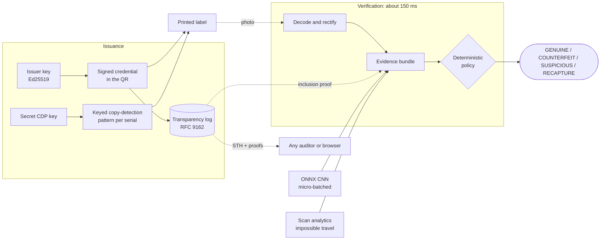

# Sigil

**Counterfeit detection you can audit.**

Sigil checks whether a product label is real by combining three independent kinds of evidence, then
applying a fixed, ordered set of rules to reach a verdict. It runs on a laptop with no API keys and no
external services.

| Evidence | What it proves | What it defeats |
|---|---|---|
| **Signed QR credential** | The label was issued by the brand (Ed25519 signature). | Made-up serial numbers and forged labels. |
| **Secret copy-detection pattern (CDP)** | This physical print is the original, not a copy of it. | Photocopies, reprints and screen replays of a real label. |
| **Public transparency log** | The brand cannot quietly add, remove or rewrite issued labels. | A dishonest operator or an insider minting labels off the books. |

```bash
uv sync
uv run sigil demo        # a narrated end-to-end run in your terminal, about 6 seconds
uv run sigil serve       # then open http://localhost:8000
```

## Contents

[The problem](#the-problem) · [How it works](#how-it-works) · [Verdicts](#verdicts) · [Key terms](#key-terms) ·
[Quickstart](#quickstart) · [Results](#results) · [What's inside](#whats-inside) ·
[Design choices](#design-choices) · [Limitations](#limitations) · [Layout and docs](#repository-layout)

## The problem

Counterfeit goods are roughly 2.5 % of world trade (OECD/EUIPO). The usual defence is a serialised QR
code that a server declares "genuine". That fails in four ways:

| Failure | Why |
|---|---|
| **A QR code is just data** | A photocopy scans exactly like the original, so "is this serial registered?" proves nothing about the object in your hand. |
| **Cloned serials** | One real label copied onto 10,000 fakes: every copy decodes to a valid serial. |
| **Trust in the operator** | The verifier is a server the brand runs. Nobody can audit what it signed or when. |
| **Binary answers** | Real photos are blurry and glare-ridden. A system that can only say yes or no is either insecure or annoying. |

Sigil replaced a 2022 prototype (`FakeProductDetector.sol`, a Next.js + Solidity 0.4 app, still in the git
history) that made all of these mistakes. It looked product IDs up on a public chain, so a photocopied
label passed. It paid gas per product. Its `transferOwnership(index, _currentOwner, _newOwner)` never
compared the caller with `_currentOwner`, so anyone could move anyone's product to any registered user.

Sigil keeps the goal, provable provenance, and replaces the mechanism: a binding between the digital
identity and the physical print, and a transparency log instead of a blockchain.

## How it works

Sigil has two sides: the brand **issues** labels, and anyone can **verify** a photo of one.



**1. Issue.** For each batch of products Sigil:
- signs a credential for every serial number and puts it in the label's QR code;
- appends the credentials to the transparency log and re-signs the log's tree head;
- generates a unique pattern for each serial from `HMAC(cdp_key, serial)` and prints it beside the QR;
- samples the batch with a simulated line camera to record its print-quality baseline.

**2. Scan.** A photo is decoded and straightened, then checked in parallel:
- the credential's signature and the issuing key's status (active or revoked, and whether the credential
  was issued before the revocation);
- the credential's inclusion in the transparency log;
- the copy-detection pattern: a small neural network compares it to the expected template, next to a
  classical correlation baseline;
- clone analytics: has this serial been scanned in places or numbers that make no sense?

Each result becomes an **evidence item** with a stable id.

**3. Decide.** A fixed rule table turns the evidence into a verdict. The first matching rule wins, so
the order is the precedence:
- a failed signature or a missing log entry is `COUNTERFEIT` whatever the pattern score says;
- `GENUINE` needs positive evidence from the signature, the log, the pattern and the clone analytics;
- anything the evidence does not settle is `SUSPICIOUS`, never `GENUINE`.

## Verdicts

| Verdict | Meaning | What the user should do |
|---|---|---|
| `GENUINE` | Signature, log entry, pattern and scan history all check out. | Trust the item. |
| `COUNTERFEIT` | A hard check failed (no valid credential in the QR, bad signature, issued after its key was revoked, or no log entry), or the pattern scores as a copy. | Do not trust the item. |
| `SUSPICIOUS` | The evidence does not settle it: an ambiguous pattern score, a serial that looks cloned, or a credential that predates its key's later revocation. | Treat with caution and investigate. |
| `RECAPTURE` | The photo is too poor to judge (blur, glare, QR not found). The response says why. | Take another photo. |

## Key terms

| Term | Plain meaning |
|---|---|
| **Credential** | The signed record in the QR code: serial number, SKU, batch and the issuer's signature. |
| **CDP (copy-detection pattern)** | A dense, noise-like print pattern that degrades measurably each time it is printed or scanned. A copy is statistically different from the original, so a model can tell them apart. The pattern is generated from a secret key, so it cannot be forged without that key. |
| **Transparency log** | An append-only public record of everything issued, built as a Merkle tree (RFC 9162). Anyone can verify that an entry is in it and that it has only grown, never been rewritten. |
| **STH (signed tree head)** | The log's signed summary at a point in time. |
| **Inclusion proof** | A short proof that one credential is in the log. |
| **Consistency proof** | A short proof that a newer log extends an older one without changing history. |
| **Rectification** | Straightening a skewed photo so the label can be read as if flat on. |
| **Micro-batching** | Grouping concurrent requests into one model call for throughput. |

## Quickstart

```bash
uv sync                          # Python 3.12+, everything needed to run
uv run sigil demo                # issue, photograph, counterfeit, verify, audit
uv run sigil serve               # API + web demo on http://localhost:8000 (/docs for OpenAPI)
docker compose up                # the same, in a container with a data volume
```

### Web demo

The first start issues two demo batches. Pick a label, "photograph" it as the genuine item or as a
photocopy, reprint or screen replay, and scan it. The verdict card shows the evidence table and timings.

A side panel verifies the transparency log **in your browser** with WebCrypto: the tree head signature,
a Merkle inclusion proof recomputed from the QR text, and a consistency proof against the last head your
browser saw. You do not have to trust the server.

### Command line

| Command | What it does |
|---|---|
| `sigil demo` | Narrated end-to-end run with evidence tables and log verification |
| `sigil serve [--host --port]` | The API and web demo |
| `sigil issue --sku X --count N [--labels DIR]` | Issue a batch (optionally write the label PNGs) |
| `sigil simulate SERIAL [--attack photocopy] -o photo.jpg` | A simulated phone photo of a label |
| `sigil scan photo.jpg [--lat --lon]` | Verify a photo |
| `sigil eval [--seeds 3] [--kinds ...] [--gate]` | Run the scenario suite and write a report |
| `sigil bench [--concurrency 1,8,32] [--duration 5]` | Inference throughput and latency, batched vs. unbatched |
| `sigil audit [--url ...]` | Act as a log witness: verify a new tree head extends the last one you saw |

### API

| Endpoint | Purpose |
|---|---|
| `POST /v1/batches` | Issue a batch (needs `X-API-Key`; `SIGIL_API_KEY`, default `dev-key`) |
| `POST /v1/scans` | Multipart photo upload (8 MB cap); returns the verdict and the evidence |
| `GET /v1/scans/{id}` | A stored scan result |
| `GET /v1/log/sth`, `/inclusion`, `/consistency` | Signed tree head and proofs, for any client to verify |
| `GET /v1/keys`, `POST /v1/keys/{kid}/revoke` | Public keys and revocation |
| `GET /metrics`, `GET /healthz` | Prometheus text and health |

`POST /v1/simulate/{serial}` and `GET /v1/labels/{serial}.png` exist for the demo only. A real deployment
never serves a label's CDP.

Development: `make lint typecheck test eval`.

## Results

Numbers come from the commands shown, on the simulated channel (see [Limitations](#limitations)).

**Scenario evals** (`sigil eval --seeds 3 --gate`)

<!-- RESULTS:EVAL:BEGIN -->
| Metric | 3 seeds (CI gate, 30 cases) | 8 seeds (80 cases) |
|---|---:|---:|
| **False accept rate** (counterfeit passed as genuine) | **0.000** (0 / 18) | **0.000** (0 / 48) |
| False reject rate (genuine called counterfeit) | 0.000 (0 / 12) | 0.000 (0 / 32) |
| Accuracy (verdict acceptable) | 0.833 | 0.887 |
| Accuracy excluding `RECAPTURE` | 0.909 | 0.949 |
| Recapture rate | 0.267 | 0.263 |

Forged and unlogged credentials are rejected by the policy in every case. The policy is deliberately
conservative: a genuine label whose pattern score falls between the copy and genuine thresholds is
`SUSPICIOUS` rather than `GENUINE`, so friction on genuine items is high (0.88 over 8 seeds) while the
false accept rate stays at zero. Deliberately hard photos ask for a retake, and genuine items whose
serial was cloned elsewhere stay `SUSPICIOUS`.
<!-- RESULTS:EVAL:END -->

**Inference serving** (`sigil bench --concurrency 1,8,32 --duration 5`)

<!-- RESULTS:BENCH:BEGIN -->
| concurrency | mode | req/s | speed-up | p50 ms | p95 ms | mean batch |
|---:|---|---:|---:|---:|---:|---:|
| 1 | unbatched | 284 | 1.00× | 3.2 | 4.9 | 1.0 |
| 1 | batched | 308 | 1.08× | 3.0 | 4.4 | 1.0 |
| 8 | unbatched | 314 | 1.00× | 24.9 | 30.6 | 1.0 |
| 8 | batched | 384 | 1.22× | 20.2 | 26.4 | 8.0 |
| 32 | unbatched | 298 | 1.00× | 104.4 | 141.4 | 1.0 |
| 32 | batched | 399 | 1.34× | 77.8 | 102.0 | 32.0 |

The model alone batches well: ONNX Runtime goes from 0.77 ms per patch at batch 1 to 0.32 ms at batch 32
(2.4× throughput). End to end the gain is capped by Amdahl's law, because about 2.5 ms of per-request
pre-processing (alignment-dependent correlation and input building) runs on the event loop. Moving
that into the batch worker is the next optimisation. Profiling also found and fixed ONNX Runtime
thread spin-waiting that starved the event loop, which cut unbatched p50 latency from 5.5 ms to 2.2 ms. Details:
[model card](docs/MODEL_CARD.md#serving-performance). This was a 4-vCPU container, single process.
<!-- RESULTS:BENCH:END -->

**CDP model, held-out channel** (details and failure analysis in the [model card](docs/MODEL_CARD.md))

<!-- RESULTS:MODEL:BEGIN -->
| | CNN (61k params) | Classical correlation |
|---|---:|---:|
| AUC, all attacks | **0.983** | 0.843 |
| AUC, photocopy | 0.9998 | 0.903 |
| AUC, high-quality reprint | 0.9998 | 0.803 |
| AUC, screen replay | 0.945 | 0.827 |
| Equal error rate | 7.5 % | — |

Measured on 3,251 decoded test captures drawn from parameter ranges the model never trained on. The
operating points were chosen on validation (genuine ≥ 0.966 keeps at most 0.5 % of counterfeits above it). Screen
replay is the weakest attack, so its ambiguous cases are reported as suspicious or sent back for a retake.
<!-- RESULTS:MODEL:END -->

## What's inside

**Trust core** &ndash; [`crypto`](src/sigil/crypto), [`ledger`](src/sigil/ledger), [`scans`](src/sigil/scans)
- Canonical binary credentials (Ed25519, base45 in QR alphanumeric mode, version 9-M), key ids and revocation.
- An RFC 9162 Merkle log in SQLite: signed tree heads, inclusion and consistency proofs, property-tested
  against the RFC vectors, plus an independent `Auditor` that detects a rewritten history.
- Clone analytics: impossible travel, geographic dispersion, scan volume and device diversity.

**Vision and inference** &ndash; [`vision`](src/sigil/vision), [`cdp`](src/sigil/cdp), [`inference`](src/sigil/inference)
- QR detection, homography rectification, ECC sub-pixel alignment and a quality gate that returns
  `RECAPTURE` instead of guessing. The same `extract_cdp_patch` and `make_input` run in training, serving
  and evals, so train/serve skew cannot creep in.
- A 61k-parameter CNN served by ONNX Runtime behind an asyncio **dynamic micro-batcher** with a bounded
  queue, per-request timeouts, Prometheus metrics and a benchmark harness. See the [model card](docs/MODEL_CARD.md).
- A parameterised print/scan channel and three attacks (photocopy, high-quality reprint, screen replay),
  with *disjoint* train and test parameter ranges to measure generalisation.

**Verification** &ndash; [`verify`](src/sigil/verify)
- Every check becomes an evidence item with a stable id. Numbers and enums only: the few strings an
  attacker controls (a label's SKU and batch text) live under an `untrusted` field.
- An ordered rule table (`R1_capture` through `R11_ambiguous`) decides. `GENUINE` needs affirmative
  evidence from the signature, the log, the pattern and the clone analytics.

**Evals** &ndash; [`evals`](src/sigil/evals)
- Ten scenario kinds from clean genuine labels to forged signatures and unlogged insider mints, each
  with a ground truth and a set of acceptable verdicts. Every case runs in its own deterministic world.
- Metrics include false-accept rate (the safety metric), false-reject rate, friction, recapture rate,
  CDP AUC and latency. `sigil eval --gate` fails CI on a regression.

## Design choices

- **Train/serve parity.** One alignment function and one input builder serve training, the API and the evals.
  The eval channel uses parameter ranges the model never trained on.
- **RFC 9162 proofs, verified client-side.** The browser demo and `sigil audit` check signed tree heads, inclusion
  and consistency proofs with their own code. The JS verifier is tested against the Python implementation.
- **Micro-batching with backpressure.** A single asyncio worker stacks concurrent requests into one ONNX call.
  A full queue returns `429` with `Retry-After` rather than growing latency without bound.
- **A policy that cannot be talked into `GENUINE`.** Hard failures (signature, key, log) are decided before
  the pattern score is looked at, and the eval gate requires zero counterfeits passed as genuine.
- **Honest failure.** A bad photo returns `RECAPTURE` with a reason, and an ambiguous scan returns `SUSPICIOUS`
  rather than a guess.

## Limitations

- **The print/scan channel is simulated.** The CDP model is trained and evaluated against a parameterised
  physical model of printers, copiers, screens and phone cameras, not real hardware. Train and test
  ranges are deliberately disjoint, but no number here predicts field performance. A real deployment
  would recalibrate on captures from the target printers and phones; the batch QC step is the hook for that.
- **The demo serves labels, including their CDP, so a browser can "photograph" them.** In production only
  the printer ever sees the template.
- **Dev key management.** Keys live in files under the data directory. The `FileKeyStore` is the seam for a KMS/HSM.
- **Single-node SQLite, in-memory proofs.** Fine at demo scale. A production log would persist tiles
  (tlog-tiles/Trillian) and gossip tree heads between witnesses; without gossip a split view is possible.
- **The first scans of a cloned serial still pass.** Clone analytics need a few scans to fire.
- **High friction on genuine items.** With no second opinion beyond the policy, ambiguous genuine labels are
  `SUSPICIOUS` or `RECAPTURE`. The thresholds trade friction against the false accept rate.

## Repository layout

```
src/sigil/
  crypto/  ledger/  scans/        trust core: credentials, transparency log, clone analytics
  cdp/  vision/  inference/       copy-detection pattern, capture pipeline, ONNX + micro-batcher
  issuance/  verify/              issuing labels; evidence, policy and the verification pipeline
  evals/                          scenarios, graders, runner, report, CI baseline
  api/  cli.py                    FastAPI app and web demo, Typer CLI
training/                         CDP model training (needs the `train` extra)
docs/                             HLD, LLD, MODEL_CARD
tests/                            unit, property, async and end-to-end API tests
```

## Documentation

- [High-level design](docs/HLD.md): problem, goals, architecture, threat model
- [Low-level design](docs/LLD.md): module contracts, formats, algorithms, test plan
- [Model card](docs/MODEL_CARD.md): the CDP CNN, its data, results and limits

## License

[MIT](LICENSE) &copy; 2026 Abhishek Thakur
